# Bill comparison report

Each bill image was read with Tesseract OCR. The table compares three things for every bill: the values printed on the image, the values the OCR API extracted from the text, and the values saved in the database after a person checked and corrected the form.

All data is fake. The values “On image” come from `bill_images/truth.json`, written by the script that drew the images, and were checked by eye against the pictures.

## Summary

- Bills compared: **20**
- OCR read all 6 details correctly: **16/20**
- Bills saved in the database: **20/20**
- Saved bills whose database values match the image: **20/20**

| Field | OCR correct |
|---|:-:|
| Bill ID | 20/20 |
| Customer name | 19/20 |
| Mobile | 20/20 |
| Products | 17/20 |
| Total amount | 19/20 |
| Printed date/time | 20/20 |

| Bill | Image quality | OCR fields matched | Database vs image |
|---|---|:-:|---|
| [B-1001](#b-1001) | Clear | 6/6 | all match |
| [B-1002](#b-1002) | Clear | 6/6 | all match |
| [B-1003](#b-1003) | Clear | 6/6 | all match |
| [B-1004](#b-1004) | Clear | 6/6 | all match |
| [B-1005](#b-1005) | Blurred + rotated | 4/6 | all match |
| [B-1006](#b-1006) | Clear | 6/6 | all match |
| [B-1007](#b-1007) | Clear | 6/6 | all match |
| [B-1008](#b-1008) | Clear | 6/6 | all match |
| [B-1009](#b-1009) | Clear | 6/6 | all match |
| [B-1010](#b-1010) | Blurred + rotated | 5/6 | all match |
| [B-1011](#b-1011) | Clear | 6/6 | all match |
| [B-1012](#b-1012) | Clear | 6/6 | all match |
| [B-1013](#b-1013) | Clear | 6/6 | all match |
| [B-1014](#b-1014) | Clear | 6/6 | all match |
| [B-1015](#b-1015) | Blurred + rotated | 5/6 | all match |
| [B-1016](#b-1016) | Clear | 6/6 | all match |
| [B-1017](#b-1017) | Clear | 6/6 | all match |
| [B-1018](#b-1018) | Clear | 6/6 | all match |
| [B-1019](#b-1019) | Clear | 6/6 | all match |
| [B-1020](#b-1020) | Blurred + rotated | 5/6 | all match |

## What caused the differences

- **Blurry or rotated images:** the four images marked “Blurred + rotated” were made softer and tilted on purpose. OCR then misread letters and digits, for example `h` → `n`, `1` → `t`, `8` → `0`, and table headers became noise.
- **OCR mistakes on missing labels:** when a label such as `TOTAL` is unreadable, the parser cannot find the value, so the field stays empty and is shown in red on the Billing page.
- **Typing errors:** any database value that differs from the image would come from the manual check step. Every saved value was compared, and the table shows ❌ wherever this happened.

## Bill by bill

### B-1001

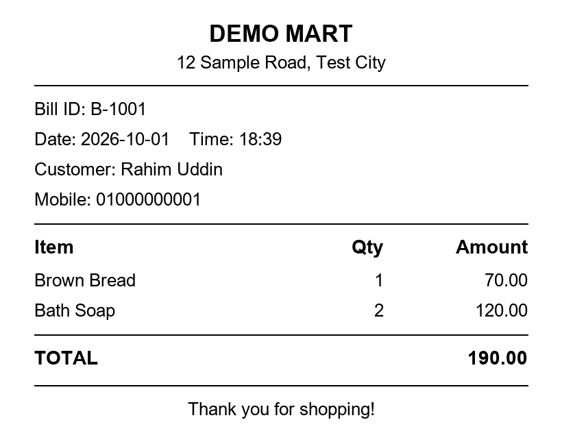

Image quality: **Clear** · OCR matched **6/6** fields · Database: **all match**

| Field | On image | OCR result | OCR | Saved in database | DB |
|---|---|---|:-:|---|:-:|
| Bill ID | B-1001 | B-1001 | ✅ | B-1001 | ✅ |
| Customer name | Rahim Uddin | Rahim Uddin | ✅ | Rahim Uddin | ✅ |
| Mobile | 01000000001 | 01000000001 | ✅ | 01000000001 | ✅ |
| Products | Brown Bread × 1 = 70.00 Bath Soap × 2 = 120.00 | Brown Bread × 1 = 70.00 Bath Soap × 2 = 120.00 | ✅ | Brown Bread × 1 = 70.00 Bath Soap × 2 = 120.00 | ✅ |
| Total amount | 190.00 | 190.00 | ✅ | 190.00 | ✅ |
| Printed date/time | 2026-10-01 18:39 | 2026-10-01 18:39 | ✅ | 2026-10-01 18:39 | ✅ |

**Result and possible reasons**

- Everything matched.

OCR full text

<pre>DEMO MART
12 Sample Road, Test City
Bill ID: B-1001
Date: 2026-10-01 Time: 18:39
Customer: Rahim Uddin
Mobile: 01000000001
Item Qty Amount
Brown Bread 1 70.00
Bath Soap 2 120.00
TOTAL 190.00
Thank you for shopping!</pre>

### B-1002

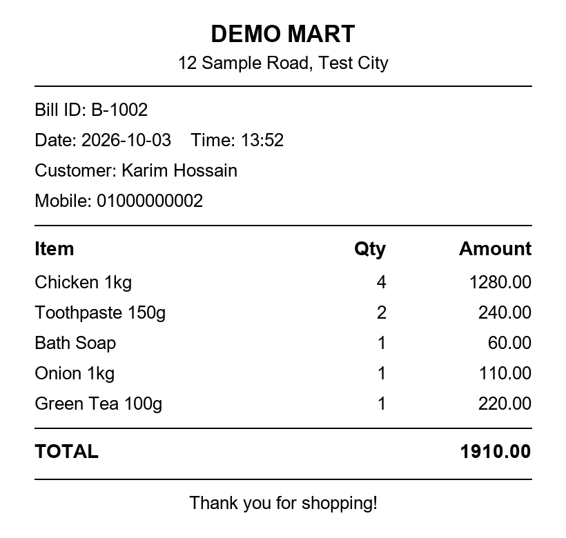

Image quality: **Clear** · OCR matched **6/6** fields · Database: **all match**

| Field | On image | OCR result | OCR | Saved in database | DB |
|---|---|---|:-:|---|:-:|
| Bill ID | B-1002 | B-1002 | ✅ | B-1002 | ✅ |
| Customer name | Karim Hossain | Karim Hossain | ✅ | Karim Hossain | ✅ |
| Mobile | 01000000002 | 01000000002 | ✅ | 01000000002 | ✅ |
| Products | Chicken 1kg × 4 = 1280.00 Toothpaste 150g × 2 = 240.00 Bath Soap × 1 = 60.00 Onion 1kg × 1 = 110.00 Green Tea 100g × 1 = 220.00 | Chicken 1kg × 4 = 1280.00 Toothpaste 150g × 2 = 240.00 Bath Soap × 1 = 60.00 Onion 1kg × 1 = 110.00 Green Tea 100g × 1 = 220.00 | ✅ | Chicken 1kg × 4 = 1280.00 Toothpaste 150g × 2 = 240.00 Bath Soap × 1 = 60.00 Onion 1kg × 1 = 110.00 Green Tea 100g × 1 = 220.00 | ✅ |
| Total amount | 1910.00 | 1910.00 | ✅ | 1910.00 | ✅ |
| Printed date/time | 2026-10-03 13:52 | 2026-10-03 13:52 | ✅ | 2026-10-03 13:52 | ✅ |

**Result and possible reasons**

- Everything matched.

OCR full text

<pre>DEMO MART
12 Sample Road, Test City
Bill ID: B-1002
Date: 2026-10-03 Time: 13:52
Customer: Karim Hossain
Mobile: 01000000002
Item Qty Amount
Chicken 1kg 4 1280.00
Toothpaste 150g 2 240.00
Bath Soap 1 60.00
Onion 1kg 1 110.00
Green Tea 100g 1 220.00
TOTAL 1910.00
Thank you for shopping!</pre>

### B-1003

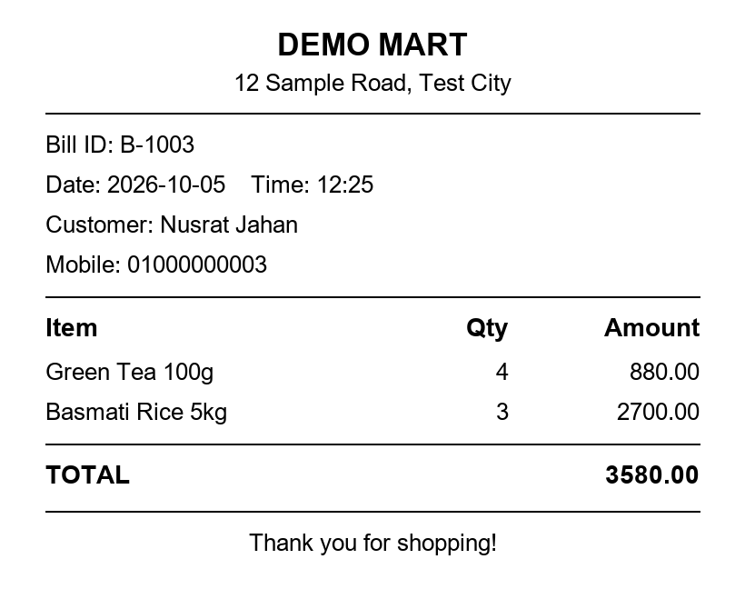

Image quality: **Clear** · OCR matched **6/6** fields · Database: **all match**

| Field | On image | OCR result | OCR | Saved in database | DB |
|---|---|---|:-:|---|:-:|
| Bill ID | B-1003 | B-1003 | ✅ | B-1003 | ✅ |
| Customer name | Nusrat Jahan | Nusrat Jahan | ✅ | Nusrat Jahan | ✅ |
| Mobile | 01000000003 | 01000000003 | ✅ | 01000000003 | ✅ |
| Products | Green Tea 100g × 4 = 880.00 Basmati Rice 5kg × 3 = 2700.00 | Green Tea 100g × 4 = 880.00 Basmati Rice 5kg × 3 = 2700.00 | ✅ | Green Tea 100g × 4 = 880.00 Basmati Rice 5kg × 3 = 2700.00 | ✅ |
| Total amount | 3580.00 | 3580.00 | ✅ | 3580.00 | ✅ |
| Printed date/time | 2026-10-05 12:25 | 2026-10-05 12:25 | ✅ | 2026-10-05 12:25 | ✅ |

**Result and possible reasons**

- Everything matched.

OCR full text

<pre>DEMO MART
12 Sample Road, Test City
Bill ID: B-1003
Date: 2026-10-05 Time: 12:25
Customer: Nusrat Jahan
Mobile: 01000000003
Item Qty Amount
Green Tea 100g 4 880.00
Basmati Rice 5kg 3 2700.00
TOTAL 3580.00
Thank you for shopping!</pre>

### B-1004

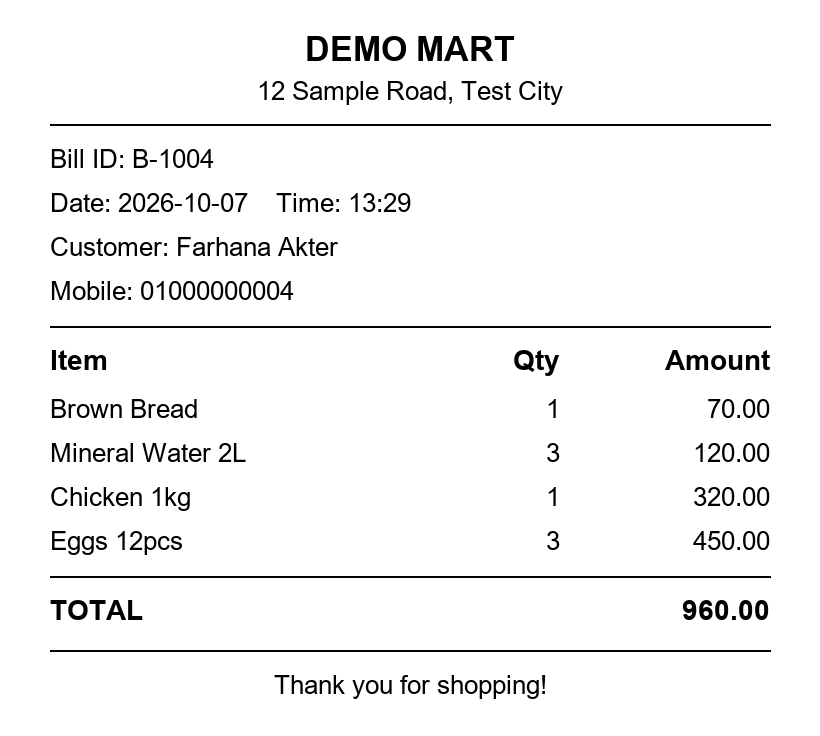

Image quality: **Clear** · OCR matched **6/6** fields · Database: **all match**

| Field | On image | OCR result | OCR | Saved in database | DB |
|---|---|---|:-:|---|:-:|
| Bill ID | B-1004 | B-1004 | ✅ | B-1004 | ✅ |
| Customer name | Farhana Akter | Farhana Akter | ✅ | Farhana Akter | ✅ |
| Mobile | 01000000004 | 01000000004 | ✅ | 01000000004 | ✅ |
| Products | Brown Bread × 1 = 70.00 Mineral Water 2L × 3 = 120.00 Chicken 1kg × 1 = 320.00 Eggs 12pcs × 3 = 450.00 | Brown Bread × 1 = 70.00 Mineral Water 2L × 3 = 120.00 Chicken 1kg × 1 = 320.00 Eggs 12pcs × 3 = 450.00 | ✅ | Brown Bread × 1 = 70.00 Mineral Water 2L × 3 = 120.00 Chicken 1kg × 1 = 320.00 Eggs 12pcs × 3 = 450.00 | ✅ |
| Total amount | 960.00 | 960.00 | ✅ | 960.00 | ✅ |
| Printed date/time | 2026-10-07 13:29 | 2026-10-07 13:29 | ✅ | 2026-10-07 13:29 | ✅ |

**Result and possible reasons**

- Everything matched.

OCR full text

<pre>DEMO MART
12 Sample Road, Test City
Bill ID: B-1004
Date: 2026-10-07 Time: 13:29
Customer: Farhana Akter
Mobile: 01000000004
Item Qty Amount
Brown Bread 1 70.00
Mineral Water 2L 3 120.00
Chicken 1kg 1 320.00
Eggs 12pcs 3 450.00
TOTAL 960.00
Thank you for shopping!</pre>

### B-1005

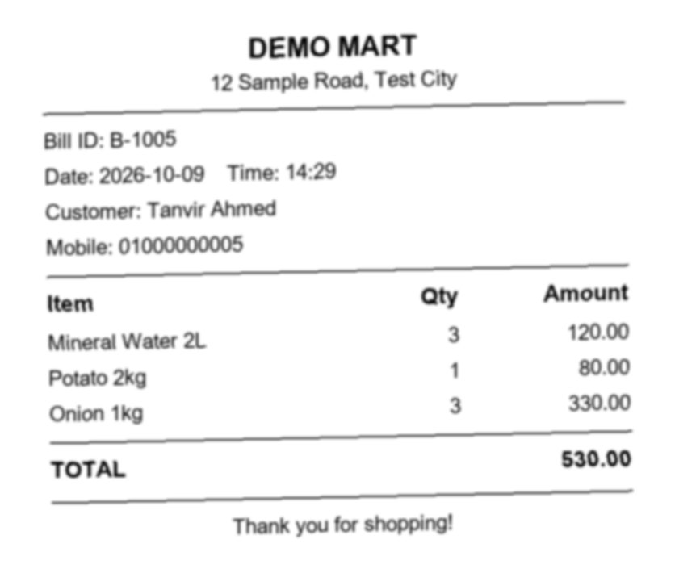

Image quality: **Blurred + rotated** · OCR matched **4/6** fields · Database: **all match**

| Field | On image | OCR result | OCR | Saved in database | DB |
|---|---|---|:-:|---|:-:|
| Bill ID | B-1005 | B-1005 | ✅ | B-1005 | ✅ |
| Customer name | Tanvir Ahmed | Tanvir Anmed | ❌ | Tanvir Ahmed | ✅ |
| Mobile | 01000000005 | 01000000005 | ✅ | 01000000005 | ✅ |
| Products | Mineral Water 2L × 3 = 120.00 Potato 2kg × 1 = 80.00 Onion 1kg × 3 = 330.00 | Mineral Water 2L × 3 = 120.00 Potato 2kg × 1 = 80.00 Onion 1kg × 3 = 330.00 | ✅ | Mineral Water 2L × 3 = 120.00 Potato 2kg × 1 = 80.00 Onion 1kg × 3 = 330.00 | ✅ |
| Total amount | 530.00 | — | ❌ | 530.00 | ✅ |
| Printed date/time | 2026-10-09 14:29 | 2026-10-09 14:29 | ✅ | 2026-10-09 14:29 | ✅ |

**Result and possible reasons**

- **Customer name** — OCR: OCR misread some characters, because the image is blurred and slightly rotated.
- **Total amount** — OCR: OCR could not find this field (the label or value was unreadable), because the image is blurred and slightly rotated.
- The wrong OCR values were corrected by hand before saving, so the database matches the image.

OCR full text

<pre>DEMO MART
12 Sample Road, Test City
———_—=—E—E—Eeeeee
Bill ID: B-1005
Date: 2026-10-09 Time: 14:29
Customer: Tanvir Anmed
Mobile: 01000000005
gee geese
Mineral Water 2L 3 120.00
Potato 2kg 1 80.00
Onion 1kg 3 330.00
lt
i
Thank you for shopping!</pre>

### B-1006

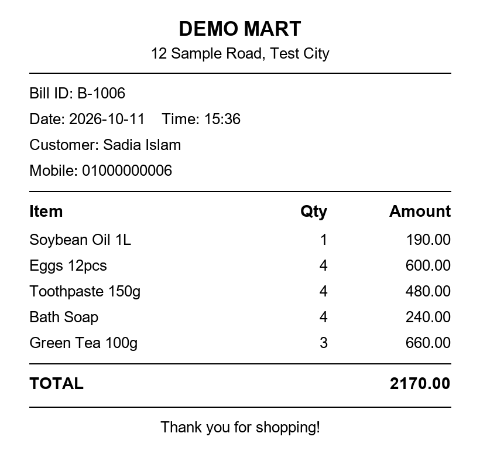

Image quality: **Clear** · OCR matched **6/6** fields · Database: **all match**

| Field | On image | OCR result | OCR | Saved in database | DB |
|---|---|---|:-:|---|:-:|
| Bill ID | B-1006 | B-1006 | ✅ | B-1006 | ✅ |
| Customer name | Sadia Islam | Sadia Islam | ✅ | Sadia Islam | ✅ |
| Mobile | 01000000006 | 01000000006 | ✅ | 01000000006 | ✅ |
| Products | Soybean Oil 1L × 1 = 190.00 Eggs 12pcs × 4 = 600.00 Toothpaste 150g × 4 = 480.00 Bath Soap × 4 = 240.00 Green Tea 100g × 3 = 660.00 | Soybean Oil 1L × 1 = 190.00 Eggs 12pcs × 4 = 600.00 Toothpaste 150g × 4 = 480.00 Bath Soap × 4 = 240.00 Green Tea 100g × 3 = 660.00 | ✅ | Soybean Oil 1L × 1 = 190.00 Eggs 12pcs × 4 = 600.00 Toothpaste 150g × 4 = 480.00 Bath Soap × 4 = 240.00 Green Tea 100g × 3 = 660.00 | ✅ |
| Total amount | 2170.00 | 2170.00 | ✅ | 2170.00 | ✅ |
| Printed date/time | 2026-10-11 15:36 | 2026-10-11 15:36 | ✅ | 2026-10-11 15:36 | ✅ |

**Result and possible reasons**

- Everything matched.

OCR full text

<pre>DEMO MART
12 Sample Road, Test City
Bill ID: B-1006
Date: 2026-10-11 Time: 15:36
Customer: Sadia Islam
Mobile: 01000000006
Item Qty Amount
Soybean Oil 1L 1 190.00
Eggs 12pcs 4 600.00
Toothpaste 150g 4 480.00
Bath Soap 4 240.00
Green Tea 100g 3 660.00
TOTAL 2170.00
Thank you for shopping!</pre>

### B-1007

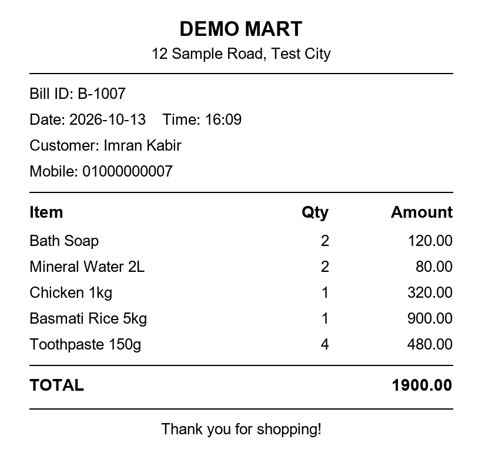

Image quality: **Clear** · OCR matched **6/6** fields · Database: **all match**

| Field | On image | OCR result | OCR | Saved in database | DB |
|---|---|---|:-:|---|:-:|
| Bill ID | B-1007 | B-1007 | ✅ | B-1007 | ✅ |
| Customer name | Imran Kabir | Imran Kabir | ✅ | Imran Kabir | ✅ |
| Mobile | 01000000007 | 01000000007 | ✅ | 01000000007 | ✅ |
| Products | Bath Soap × 2 = 120.00 Mineral Water 2L × 2 = 80.00 Chicken 1kg × 1 = 320.00 Basmati Rice 5kg × 1 = 900.00 Toothpaste 150g × 4 = 480.00 | Bath Soap × 2 = 120.00 Mineral Water 2L × 2 = 80.00 Chicken 1kg × 1 = 320.00 Basmati Rice 5kg × 1 = 900.00 Toothpaste 150g × 4 = 480.00 | ✅ | Bath Soap × 2 = 120.00 Mineral Water 2L × 2 = 80.00 Chicken 1kg × 1 = 320.00 Basmati Rice 5kg × 1 = 900.00 Toothpaste 150g × 4 = 480.00 | ✅ |
| Total amount | 1900.00 | 1900.00 | ✅ | 1900.00 | ✅ |
| Printed date/time | 2026-10-13 16:09 | 2026-10-13 16:09 | ✅ | 2026-10-13 16:09 | ✅ |

**Result and possible reasons**

- Everything matched.

OCR full text

<pre>DEMO MART
12 Sample Road, Test City
Bill ID: B-1007
Date: 2026-10-13 Time: 16:09
Customer: Imran Kabir
Mobile: 01000000007
Item Qty Amount
Bath Soap 2 120.00
Mineral Water 2L 2 80.00
Chicken 1kg 1 320.00
Basmati Rice 5kg 1 900.00
Toothpaste 150g 4 480.00
TOTAL 1900.00
Thank you for shopping!</pre>

### B-1008

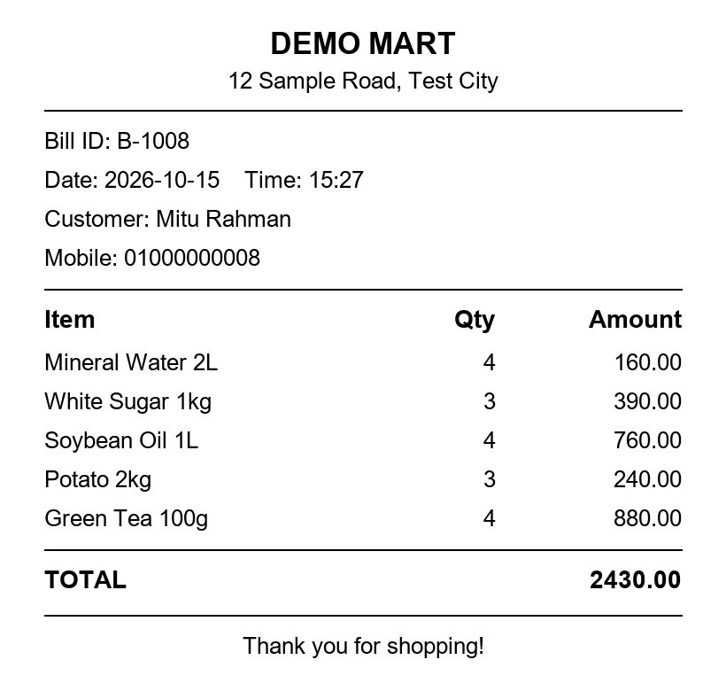

Image quality: **Clear** · OCR matched **6/6** fields · Database: **all match**

| Field | On image | OCR result | OCR | Saved in database | DB |
|---|---|---|:-:|---|:-:|
| Bill ID | B-1008 | B-1008 | ✅ | B-1008 | ✅ |
| Customer name | Mitu Rahman | Mitu Rahman | ✅ | Mitu Rahman | ✅ |
| Mobile | 01000000008 | 01000000008 | ✅ | 01000000008 | ✅ |
| Products | Mineral Water 2L × 4 = 160.00 White Sugar 1kg × 3 = 390.00 Soybean Oil 1L × 4 = 760.00 Potato 2kg × 3 = 240.00 Green Tea 100g × 4 = 880.00 | Mineral Water 2L × 4 = 160.00 White Sugar 1kg × 3 = 390.00 Soybean Oil 1L × 4 = 760.00 Potato 2kg × 3 = 240.00 Green Tea 100g × 4 = 880.00 | ✅ | Mineral Water 2L × 4 = 160.00 White Sugar 1kg × 3 = 390.00 Soybean Oil 1L × 4 = 760.00 Potato 2kg × 3 = 240.00 Green Tea 100g × 4 = 880.00 | ✅ |
| Total amount | 2430.00 | 2430.00 | ✅ | 2430.00 | ✅ |
| Printed date/time | 2026-10-15 15:27 | 2026-10-15 15:27 | ✅ | 2026-10-15 15:27 | ✅ |

**Result and possible reasons**

- Everything matched.

OCR full text

<pre>DEMO MART
12 Sample Road, Test City
Bill ID: B-1008
Date: 2026-10-15 Time: 15:27
Customer: Mitu Rahman
Mobile: 01000000008
Item Qty Amount
Mineral Water 2L 4 160.00
White Sugar 1kg 3 390.00
Soybean Oil 1L 4 760.00
Potato 2kg 3 240.00
Green Tea 100g 4 880.00
TOTAL 2430.00
Thank you for shopping!</pre>

### B-1009

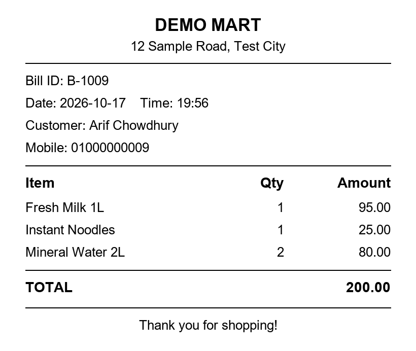

Image quality: **Clear** · OCR matched **6/6** fields · Database: **all match**

| Field | On image | OCR result | OCR | Saved in database | DB |
|---|---|---|:-:|---|:-:|
| Bill ID | B-1009 | B-1009 | ✅ | B-1009 | ✅ |
| Customer name | Arif Chowdhury | Arif Chowdhury | ✅ | Arif Chowdhury | ✅ |
| Mobile | 01000000009 | 01000000009 | ✅ | 01000000009 | ✅ |
| Products | Fresh Milk 1L × 1 = 95.00 Instant Noodles × 1 = 25.00 Mineral Water 2L × 2 = 80.00 | Fresh Milk 1L × 1 = 95.00 Instant Noodles × 1 = 25.00 Mineral Water 2L × 2 = 80.00 | ✅ | Fresh Milk 1L × 1 = 95.00 Instant Noodles × 1 = 25.00 Mineral Water 2L × 2 = 80.00 | ✅ |
| Total amount | 200.00 | 200.00 | ✅ | 200.00 | ✅ |
| Printed date/time | 2026-10-17 19:56 | 2026-10-17 19:56 | ✅ | 2026-10-17 19:56 | ✅ |

**Result and possible reasons**

- Everything matched.

OCR full text

<pre>DEMO MART
12 Sample Road, Test City
Bill ID: B-1009
Date: 2026-10-17 Time: 19:56
Customer: Arif Chowdhury
Mobile: 01000000009
Item Qty Amount
Fresh Milk 1L 1 95.00
Instant Noodles 1 25.00
Mineral Water 2L 2 80.00
TOTAL 200.00
Thank you for shopping!</pre>

### B-1010

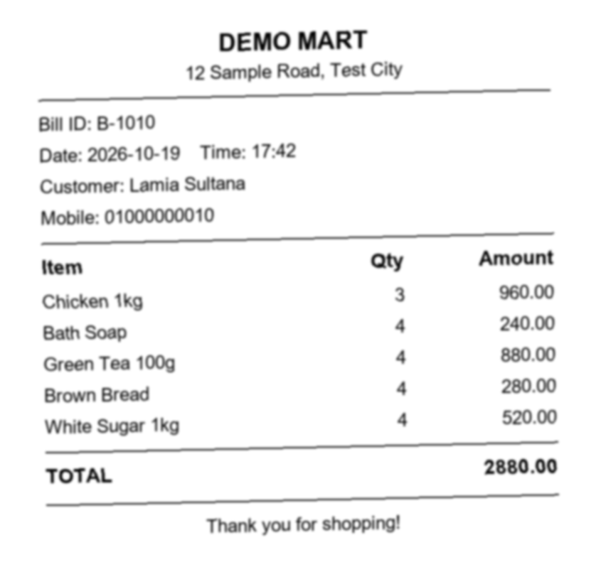

Image quality: **Blurred + rotated** · OCR matched **5/6** fields · Database: **all match**

| Field | On image | OCR result | OCR | Saved in database | DB |
|---|---|---|:-:|---|:-:|
| Bill ID | B-1010 | B-1010 | ✅ | B-1010 | ✅ |
| Customer name | Lamia Sultana | Lamia Sultana | ✅ | Lamia Sultana | ✅ |
| Mobile | 01000000010 | 01000000010 | ✅ | 01000000010 | ✅ |
| Products | Chicken 1kg × 3 = 960.00 Bath Soap × 4 = 240.00 Green Tea 100g × 4 = 880.00 Brown Bread × 4 = 280.00 White Sugar 1kg × 4 = 520.00 | Chicken tkg × 3 = 900.00 Bath Soap × 4 = 240.00 Green Tea 100g × 4 = 880.00 Brown Bread × 4 = 200.00 White Sugar 1kg × 4 = 520.00 | ❌ | Chicken 1kg × 3 = 960.00 Bath Soap × 4 = 240.00 Green Tea 100g × 4 = 880.00 Brown Bread × 4 = 280.00 White Sugar 1kg × 4 = 520.00 | ✅ |
| Total amount | 2880.00 | 2880.00 | ✅ | 2880.00 | ✅ |
| Printed date/time | 2026-10-19 17:42 | 2026-10-19 17:42 | ✅ | 2026-10-19 17:42 | ✅ |

**Result and possible reasons**

- **Products** — OCR: OCR misread or skipped a product line, because the image is blurred and slightly rotated.
- The wrong OCR values were corrected by hand before saving, so the database matches the image.

OCR full text

<pre>DEMO MART
12 Sample Road, Test City
a OeSe——
Bill 1D: B-1010
Date: 2026-10-19 Time: 17:42
Customer: Lamia Sultana
Mobile: 01000000010
es
Chicken tkg 3 900.00
Bath Soap 4 240.00
Green Tea 100g 4 880.00
Brown Bread 4 200.00
White Sugar 1kg 4 520.00
et
TOTAL 2880.00
OO ———
Thank you for shopping!</pre>

### B-1011

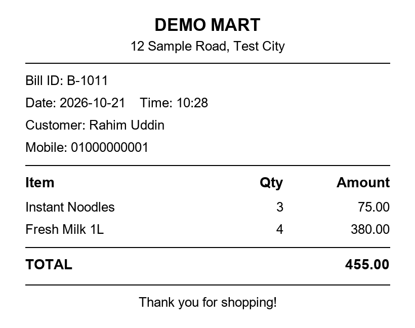

Image quality: **Clear** · OCR matched **6/6** fields · Database: **all match**

| Field | On image | OCR result | OCR | Saved in database | DB |
|---|---|---|:-:|---|:-:|
| Bill ID | B-1011 | B-1011 | ✅ | B-1011 | ✅ |
| Customer name | Rahim Uddin | Rahim Uddin | ✅ | Rahim Uddin | ✅ |
| Mobile | 01000000001 | 01000000001 | ✅ | 01000000001 | ✅ |
| Products | Instant Noodles × 3 = 75.00 Fresh Milk 1L × 4 = 380.00 | Instant Noodles × 3 = 75.00 Fresh Milk 1L × 4 = 380.00 | ✅ | Instant Noodles × 3 = 75.00 Fresh Milk 1L × 4 = 380.00 | ✅ |
| Total amount | 455.00 | 455.00 | ✅ | 455.00 | ✅ |
| Printed date/time | 2026-10-21 10:28 | 2026-10-21 10:28 | ✅ | 2026-10-21 10:28 | ✅ |

**Result and possible reasons**

- Everything matched.

OCR full text

<pre>DEMO MART
12 Sample Road, Test City
Bill ID: B-1011
Date: 2026-10-21 Time: 10:28
Customer: Rahim Uddin
Mobile: 01000000001
Item Qty Amount
Instant Noodles 3 75.00
Fresh Milk 1L 4 380.00
TOTAL 455.00
Thank you for shopping!</pre>

### B-1012

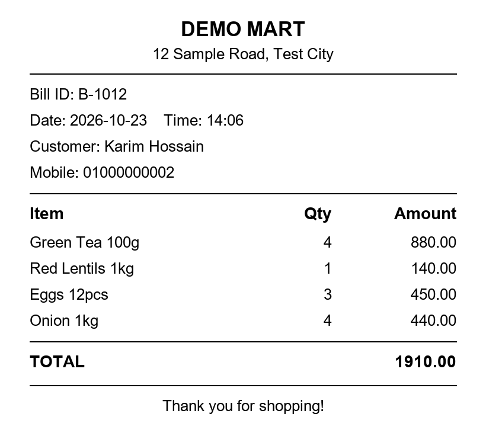

Image quality: **Clear** · OCR matched **6/6** fields · Database: **all match**

| Field | On image | OCR result | OCR | Saved in database | DB |
|---|---|---|:-:|---|:-:|
| Bill ID | B-1012 | B-1012 | ✅ | B-1012 | ✅ |
| Customer name | Karim Hossain | Karim Hossain | ✅ | Karim Hossain | ✅ |
| Mobile | 01000000002 | 01000000002 | ✅ | 01000000002 | ✅ |
| Products | Green Tea 100g × 4 = 880.00 Red Lentils 1kg × 1 = 140.00 Eggs 12pcs × 3 = 450.00 Onion 1kg × 4 = 440.00 | Green Tea 100g × 4 = 880.00 Red Lentils 1kg × 1 = 140.00 Eggs 12pcs × 3 = 450.00 Onion 1kg × 4 = 440.00 | ✅ | Green Tea 100g × 4 = 880.00 Red Lentils 1kg × 1 = 140.00 Eggs 12pcs × 3 = 450.00 Onion 1kg × 4 = 440.00 | ✅ |
| Total amount | 1910.00 | 1910.00 | ✅ | 1910.00 | ✅ |
| Printed date/time | 2026-10-23 14:06 | 2026-10-23 14:06 | ✅ | 2026-10-23 14:06 | ✅ |

**Result and possible reasons**

- Everything matched.

OCR full text

<pre>DEMO MART
12 Sample Road, Test City
Bill ID: B-1012
Date: 2026-10-23 Time: 14:06
Customer: Karim Hossain
Mobile: 01000000002
Item Qty Amount
Green Tea 100g 4 880.00
Red Lentils 1kg 1 140.00
Eggs 12pcs 3 450.00
Onion 1kg 4 440.00
TOTAL 1910.00
Thank you for shopping!</pre>

### B-1013

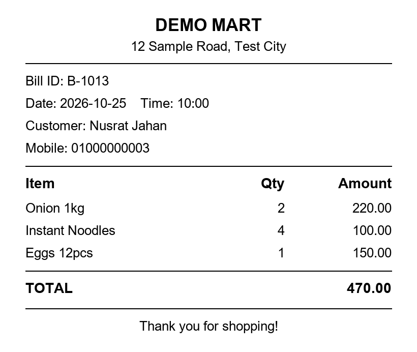

Image quality: **Clear** · OCR matched **6/6** fields · Database: **all match**

| Field | On image | OCR result | OCR | Saved in database | DB |
|---|---|---|:-:|---|:-:|
| Bill ID | B-1013 | B-1013 | ✅ | B-1013 | ✅ |
| Customer name | Nusrat Jahan | Nusrat Jahan | ✅ | Nusrat Jahan | ✅ |
| Mobile | 01000000003 | 01000000003 | ✅ | 01000000003 | ✅ |
| Products | Onion 1kg × 2 = 220.00 Instant Noodles × 4 = 100.00 Eggs 12pcs × 1 = 150.00 | Onion 1kg × 2 = 220.00 Instant Noodles × 4 = 100.00 Eggs 12pcs × 1 = 150.00 | ✅ | Onion 1kg × 2 = 220.00 Instant Noodles × 4 = 100.00 Eggs 12pcs × 1 = 150.00 | ✅ |
| Total amount | 470.00 | 470.00 | ✅ | 470.00 | ✅ |
| Printed date/time | 2026-10-25 10:00 | 2026-10-25 10:00 | ✅ | 2026-10-25 10:00 | ✅ |

**Result and possible reasons**

- Everything matched.

OCR full text

<pre>DEMO MART
12 Sample Road, Test City
Bill ID: B-1013
Date: 2026-10-25 Time: 10:00
Customer: Nusrat Jahan
Mobile: 01000000003
Item Qty Amount
Onion 1kg 2 220.00
Instant Noodles 4 100.00
Eggs 12pcs 1 150.00
TOTAL 470.00
Thank you for shopping!</pre>

### B-1014

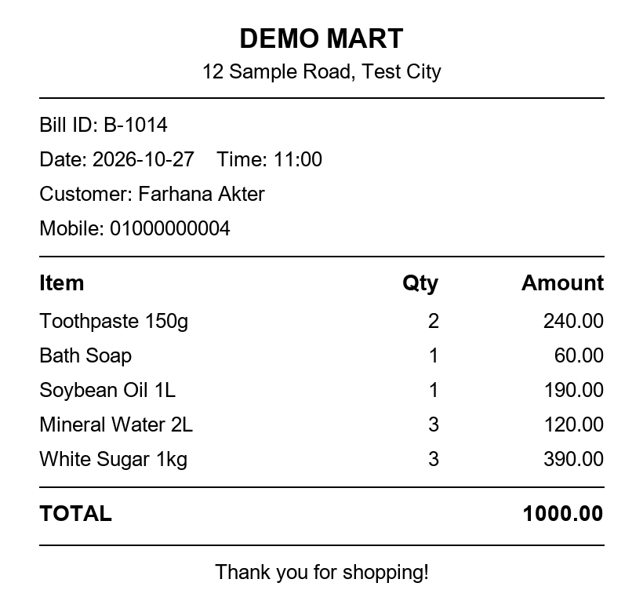

Image quality: **Clear** · OCR matched **6/6** fields · Database: **all match**

| Field | On image | OCR result | OCR | Saved in database | DB |
|---|---|---|:-:|---|:-:|
| Bill ID | B-1014 | B-1014 | ✅ | B-1014 | ✅ |
| Customer name | Farhana Akter | Farhana Akter | ✅ | Farhana Akter | ✅ |
| Mobile | 01000000004 | 01000000004 | ✅ | 01000000004 | ✅ |
| Products | Toothpaste 150g × 2 = 240.00 Bath Soap × 1 = 60.00 Soybean Oil 1L × 1 = 190.00 Mineral Water 2L × 3 = 120.00 White Sugar 1kg × 3 = 390.00 | Toothpaste 150g × 2 = 240.00 Bath Soap × 1 = 60.00 Soybean Oil 1L × 1 = 190.00 Mineral Water 2L × 3 = 120.00 White Sugar 1kg × 3 = 390.00 | ✅ | Toothpaste 150g × 2 = 240.00 Bath Soap × 1 = 60.00 Soybean Oil 1L × 1 = 190.00 Mineral Water 2L × 3 = 120.00 White Sugar 1kg × 3 = 390.00 | ✅ |
| Total amount | 1000.00 | 1000.00 | ✅ | 1000.00 | ✅ |
| Printed date/time | 2026-10-27 11:00 | 2026-10-27 11:00 | ✅ | 2026-10-27 11:00 | ✅ |

**Result and possible reasons**

- Everything matched.

OCR full text

<pre>DEMO MART
12 Sample Road, Test City
Bill ID: B-1014
Date: 2026-10-27 Time: 11:00
Customer: Farhana Akter
Mobile: 01000000004
Item Qty Amount
Toothpaste 150g 2 240.00
Bath Soap 1 60.00
Soybean Oil 1L 1 190.00
Mineral Water 2L 3 120.00
White Sugar 1kg 3 390.00
TOTAL 1000.00
Thank you for shopping!</pre>

### B-1015

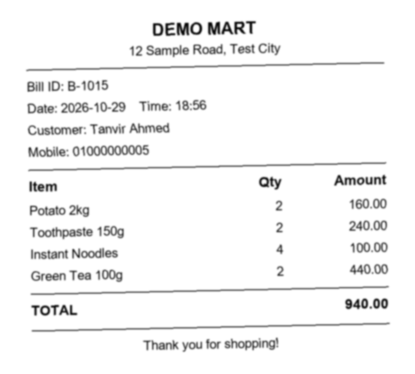

Image quality: **Blurred + rotated** · OCR matched **5/6** fields · Database: **all match**

| Field | On image | OCR result | OCR | Saved in database | DB |
|---|---|---|:-:|---|:-:|
| Bill ID | B-1015 | B-1015 | ✅ | B-1015 | ✅ |
| Customer name | Tanvir Ahmed | Tanvir Ahmed | ✅ | Tanvir Ahmed | ✅ |
| Mobile | 01000000005 | 01000000005 | ✅ | 01000000005 | ✅ |
| Products | Potato 2kg × 2 = 160.00 Toothpaste 150g × 2 = 240.00 Instant Noodles × 4 = 100.00 Green Tea 100g × 2 = 440.00 | Potato 2kg × 2 = 160.00 Toothpaste 150g × 2 = 240.00 Green Tea 100g × 2 = 440.00 | ❌ | Potato 2kg × 2 = 160.00 Toothpaste 150g × 2 = 240.00 Instant Noodles × 4 = 100.00 Green Tea 100g × 2 = 440.00 | ✅ |
| Total amount | 940.00 | 940.00 | ✅ | 940.00 | ✅ |
| Printed date/time | 2026-10-29 18:56 | 2026-10-29 18:56 | ✅ | 2026-10-29 18:56 | ✅ |

**Result and possible reasons**

- **Products** — OCR: OCR misread or skipped a product line, because the image is blurred and slightly rotated.
- The wrong OCR values were corrected by hand before saving, so the database matches the image.

OCR full text

<pre>DEMO MART
12 Sample Road, Test City
eee
Bill ID: B-1015
Date: 2026-10-29 Time: 18:56
Customer: Tanvir Ahmed
Mobile: 01000000005
eee
Potato 2kg 2 160.00
Toothpaste 150g 2 240.00
Instant Noodles 4 wees
Green Tea 100g 2 440.00
ee
TOTAL 940.00
Or
Thank you for shopping!</pre>

### B-1016

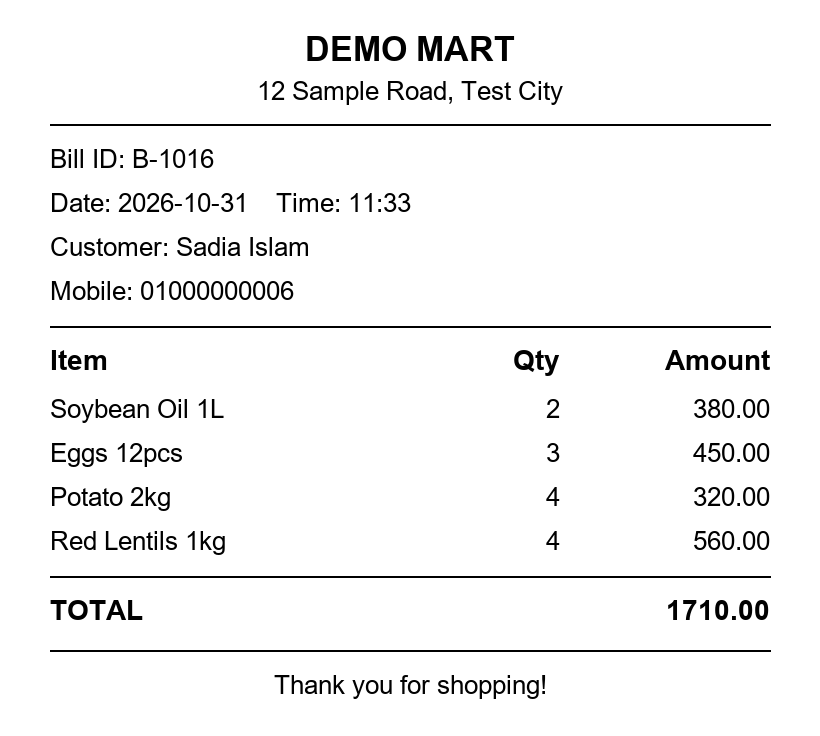

Image quality: **Clear** · OCR matched **6/6** fields · Database: **all match**

| Field | On image | OCR result | OCR | Saved in database | DB |
|---|---|---|:-:|---|:-:|
| Bill ID | B-1016 | B-1016 | ✅ | B-1016 | ✅ |
| Customer name | Sadia Islam | Sadia Islam | ✅ | Sadia Islam | ✅ |
| Mobile | 01000000006 | 01000000006 | ✅ | 01000000006 | ✅ |
| Products | Soybean Oil 1L × 2 = 380.00 Eggs 12pcs × 3 = 450.00 Potato 2kg × 4 = 320.00 Red Lentils 1kg × 4 = 560.00 | Soybean Oil 1L × 2 = 380.00 Eggs 12pcs × 3 = 450.00 Potato 2kg × 4 = 320.00 Red Lentils 1kg × 4 = 560.00 | ✅ | Soybean Oil 1L × 2 = 380.00 Eggs 12pcs × 3 = 450.00 Potato 2kg × 4 = 320.00 Red Lentils 1kg × 4 = 560.00 | ✅ |
| Total amount | 1710.00 | 1710.00 | ✅ | 1710.00 | ✅ |
| Printed date/time | 2026-10-31 11:33 | 2026-10-31 11:33 | ✅ | 2026-10-31 11:33 | ✅ |

**Result and possible reasons**

- Everything matched.

OCR full text

<pre>DEMO MART
12 Sample Road, Test City
Bill ID: B-1016
Date: 2026-10-31 Time: 11:33
Customer: Sadia Islam
Mobile: 01000000006
Item Qty Amount
Soybean Oil 1L 2 380.00
Eggs 12pcs 3 450.00
Potato 2kg 4 320.00
Red Lentils 1kg 4 560.00
TOTAL 1710.00
Thank you for shopping!</pre>

### B-1017

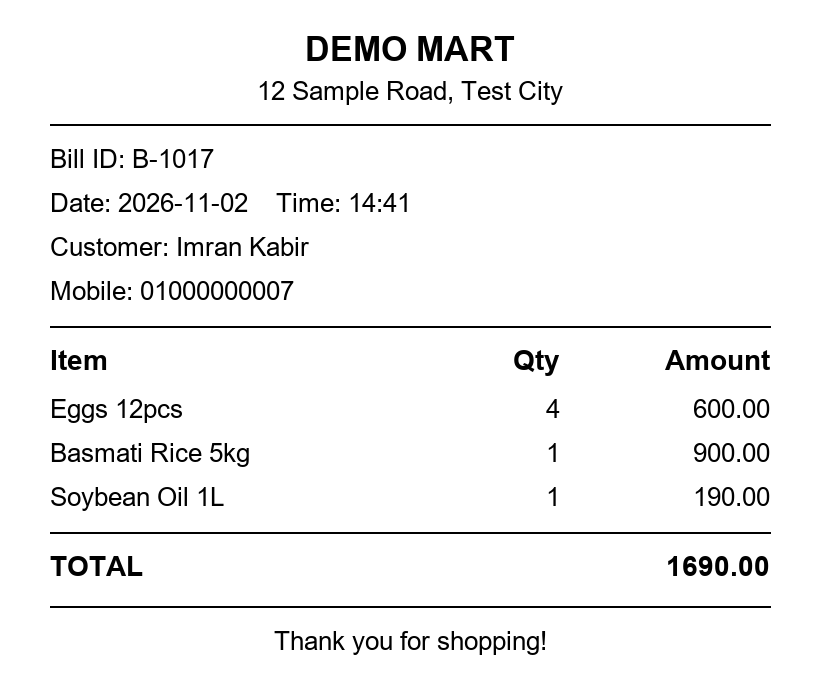

Image quality: **Clear** · OCR matched **6/6** fields · Database: **all match**

| Field | On image | OCR result | OCR | Saved in database | DB |
|---|---|---|:-:|---|:-:|
| Bill ID | B-1017 | B-1017 | ✅ | B-1017 | ✅ |
| Customer name | Imran Kabir | Imran Kabir | ✅ | Imran Kabir | ✅ |
| Mobile | 01000000007 | 01000000007 | ✅ | 01000000007 | ✅ |
| Products | Eggs 12pcs × 4 = 600.00 Basmati Rice 5kg × 1 = 900.00 Soybean Oil 1L × 1 = 190.00 | Eggs 12pcs × 4 = 600.00 Basmati Rice 5kg × 1 = 900.00 Soybean Oil 1L × 1 = 190.00 | ✅ | Eggs 12pcs × 4 = 600.00 Basmati Rice 5kg × 1 = 900.00 Soybean Oil 1L × 1 = 190.00 | ✅ |
| Total amount | 1690.00 | 1690.00 | ✅ | 1690.00 | ✅ |
| Printed date/time | 2026-11-02 14:41 | 2026-11-02 14:41 | ✅ | 2026-11-02 14:41 | ✅ |

**Result and possible reasons**

- Everything matched.

OCR full text

<pre>DEMO MART
12 Sample Road, Test City
Bill ID: B-1017
Date: 2026-11-02 Time: 14:41
Customer: Imran Kabir
Mobile: 01000000007
Item Qty Amount
Eggs 12pcs 4 600.00
Basmati Rice 5kg 1 900.00
Soybean Oil 1L 1 190.00
TOTAL 1690.00
Thank you for shopping!</pre>

### B-1018

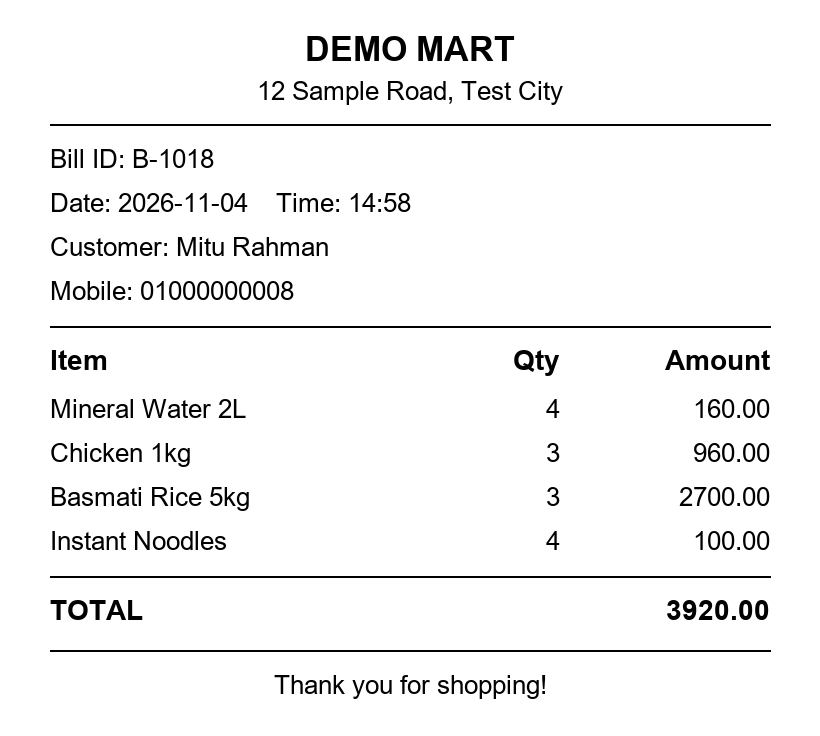

Image quality: **Clear** · OCR matched **6/6** fields · Database: **all match**

| Field | On image | OCR result | OCR | Saved in database | DB |
|---|---|---|:-:|---|:-:|
| Bill ID | B-1018 | B-1018 | ✅ | B-1018 | ✅ |
| Customer name | Mitu Rahman | Mitu Rahman | ✅ | Mitu Rahman | ✅ |
| Mobile | 01000000008 | 01000000008 | ✅ | 01000000008 | ✅ |
| Products | Mineral Water 2L × 4 = 160.00 Chicken 1kg × 3 = 960.00 Basmati Rice 5kg × 3 = 2700.00 Instant Noodles × 4 = 100.00 | Mineral Water 2L × 4 = 160.00 Chicken 1kg × 3 = 960.00 Basmati Rice 5kg × 3 = 2700.00 Instant Noodles × 4 = 100.00 | ✅ | Mineral Water 2L × 4 = 160.00 Chicken 1kg × 3 = 960.00 Basmati Rice 5kg × 3 = 2700.00 Instant Noodles × 4 = 100.00 | ✅ |
| Total amount | 3920.00 | 3920.00 | ✅ | 3920.00 | ✅ |
| Printed date/time | 2026-11-04 14:58 | 2026-11-04 14:58 | ✅ | 2026-11-04 14:58 | ✅ |

**Result and possible reasons**

- Everything matched.

OCR full text

<pre>DEMO MART
12 Sample Road, Test City
Bill ID: B-1018
Date: 2026-11-04 Time: 14:58
Customer: Mitu Rahman
Mobile: 01000000008
Item Qty Amount
Mineral Water 2L 4 160.00
Chicken 1kg 3 960.00
Basmati Rice 5kg 3 2700.00
Instant Noodles 4 100.00
TOTAL 3920.00
Thank you for shopping!</pre>

### B-1019

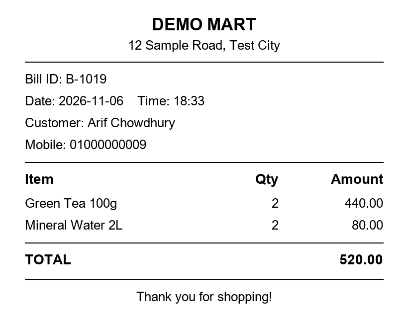

Image quality: **Clear** · OCR matched **6/6** fields · Database: **all match**

| Field | On image | OCR result | OCR | Saved in database | DB |
|---|---|---|:-:|---|:-:|
| Bill ID | B-1019 | B-1019 | ✅ | B-1019 | ✅ |
| Customer name | Arif Chowdhury | Arif Chowdhury | ✅ | Arif Chowdhury | ✅ |
| Mobile | 01000000009 | 01000000009 | ✅ | 01000000009 | ✅ |
| Products | Green Tea 100g × 2 = 440.00 Mineral Water 2L × 2 = 80.00 | Green Tea 100g × 2 = 440.00 Mineral Water 2L × 2 = 80.00 | ✅ | Green Tea 100g × 2 = 440.00 Mineral Water 2L × 2 = 80.00 | ✅ |
| Total amount | 520.00 | 520.00 | ✅ | 520.00 | ✅ |
| Printed date/time | 2026-11-06 18:33 | 2026-11-06 18:33 | ✅ | 2026-11-06 18:33 | ✅ |

**Result and possible reasons**

- Everything matched.

OCR full text

<pre>DEMO MART
12 Sample Road, Test City
Bill ID: B-1019
Date: 2026-11-06 Time: 18:33
Customer: Arif Chowdhury
Mobile: 01000000009
Item Qty Amount
Green Tea 100g 2 440.00
Mineral Water 2L 2 80.00
TOTAL 520.00
Thank you for shopping!</pre>

### B-1020

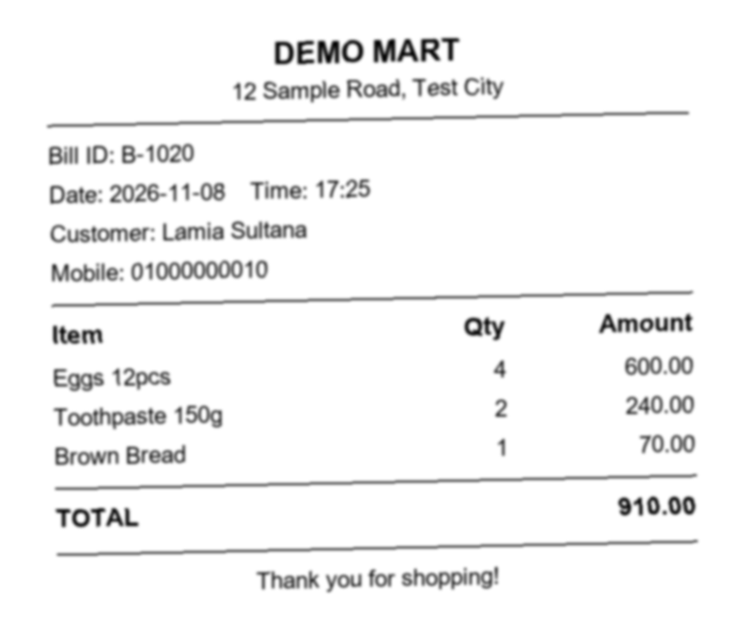

Image quality: **Blurred + rotated** · OCR matched **5/6** fields · Database: **all match**

| Field | On image | OCR result | OCR | Saved in database | DB |
|---|---|---|:-:|---|:-:|
| Bill ID | B-1020 | B-1020 | ✅ | B-1020 | ✅ |
| Customer name | Lamia Sultana | Lamia Sultana | ✅ | Lamia Sultana | ✅ |
| Mobile | 01000000010 | 01000000010 | ✅ | 01000000010 | ✅ |
| Products | Eggs 12pcs × 4 = 600.00 Toothpaste 150g × 2 = 240.00 Brown Bread × 1 = 70.00 | Eggs 12908 × 4 = 600.00 Toothpaste 150g × 2 = 240.00 Brown Bread × 1 = 70.00 | ❌ | Eggs 12pcs × 4 = 600.00 Toothpaste 150g × 2 = 240.00 Brown Bread × 1 = 70.00 | ✅ |
| Total amount | 910.00 | 910.00 | ✅ | 910.00 | ✅ |
| Printed date/time | 2026-11-08 17:25 | 2026-11-08 17:25 | ✅ | 2026-11-08 17:25 | ✅ |

**Result and possible reasons**

- **Products** — OCR: OCR misread or skipped a product line, because the image is blurred and slightly rotated.
- The wrong OCR values were corrected by hand before saving, so the database matches the image.

OCR full text

<pre>DEMO MART
12 Sample Road, Test City
renee each eee
Bill ID: B-1020
Date: 2026-11-08 Time: 17:25
Customer: Lamia Sultana
Mobile: 01000000010
enh
Eggs 12908 4 600.00
Toothpaste 150g 2 240.00
Brown Bread 1 70.00
ee
TOTAL 910.00
eh
Thank you for shopping!</pre>

